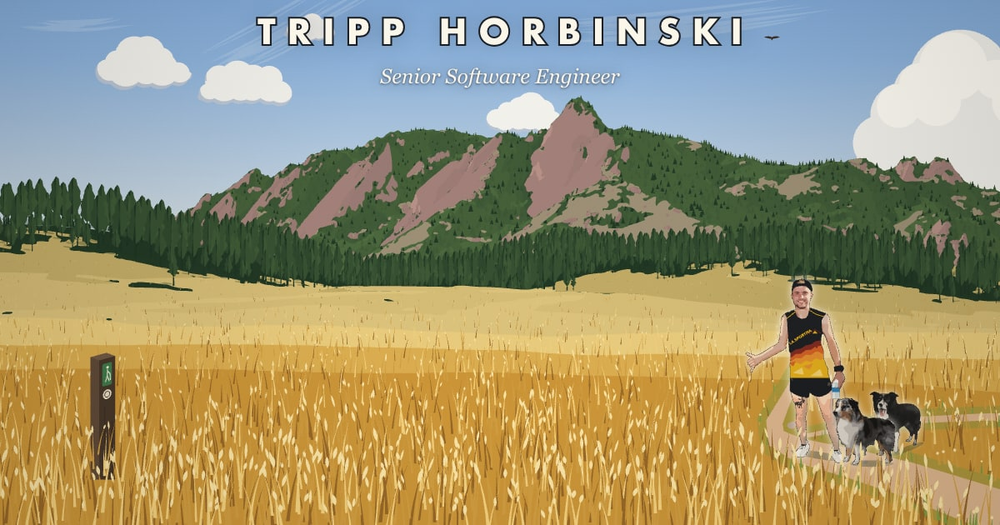

# tripp.horbin.ski

My personal site: one page that opens on a generated scene of the Flatirons from Chautauqua Meadow in Boulder, then gets to my work by the numbers, the projects behind them, and how to reach me.

**Live at [tripp.horbin.ski](https://tripp.horbin.ski/).** Built with [Claude Code](https://claude.com/claude-code).



## How it's built

A static Next.js 16 export with React 19 and Tailwind CSS, deployed to GitHub Pages. Most of the interesting work runs at build time, on my machine, and is committed as generated TypeScript, so the browser only draws.

### The meadow

The mountain isn't drawn. It's computed from public data by the scripts in [`scripts/meadow/`](scripts/meadow):

1. `npm run meadow:fetch` downloads USGS 3DEP lidar elevation and NAIP aerial imagery into a gitignored cache.
2. `npm run meadow:render` turns them into [`src/lib/meadow/terrain.ts`](src/lib/meadow/terrain.ts): the rock and forest areas, each with its surface normal, the rolling hills, and every tree, placed where the imagery shows canopy and sized by how dense it is.
3. The canvas engine in [`src/lib/meadow/`](src/lib/meadow) lights those surfaces and casts the trees' shadows from the sun's real position ([suncalc](https://github.com/mourner/suncalc)) for whatever hour you pick in the Options panel.

### The figures

Me and my dogs are screen prints traced from photos. Apple's Vision framework cuts the subject out (`scripts/meadow/segment.swift`, macOS only), a script repairs what the photo hides, k-means in Lab color separates it into flat inks, and potrace turns each ink into vector paths. Only the traced inks are committed, not the photos.

### The resume

[`src/content/career.ts`](src/content/career.ts) is the single source for both the homepage and the resume. On paper the page swaps to a print-only layout, so printing the homepage prints the resume, and `npm run resume:pdf` saves that as the PDF the site links to.

### Infrastructure and deploys

- **Deploys:** pushing to `main` runs [a GitHub Actions workflow](.github/workflows/nextjs.yml) that builds the static export and publishes it to GitHub Pages.
- **DNS:** [`main.tf`](main.tf) is Terraform for the domain's Route 53 records and an ACM certificate.

## Running it

```sh
npm install
npm run dev    # http://localhost:3000
npm run build  # static export to out/
```

The generated files are committed, so none of the pipeline scripts are needed to run the site. Rebuilding a figure takes its source photo and macOS.

## Credits

The Vitruvian Man is Leonardo da Vinci's drawing (c. 1490), from Luc Viatour's photograph on Wikimedia Commons. Elevation and imagery are from the U.S. Geological Survey.
